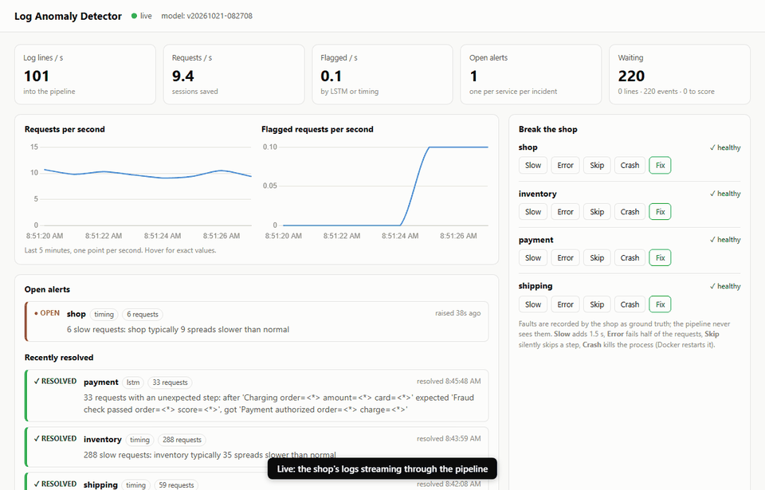
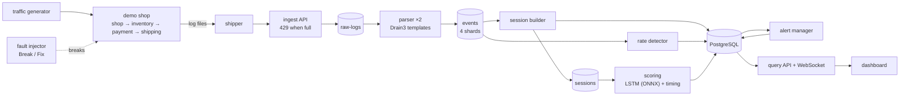

# Log Anomaly Detector

A live log anomaly detection system. A small shop made of microservices writes
logs; a streaming pipeline parses them, groups them into requests, scores every
request with three detectors, and turns anomalies into explained alerts on a
dashboard, within seconds. It stays correct when workers crash, and every
number below comes from a script you can re-run.



| | |
|---|---|
| **Faults caught** (live, 22 injected) | every slow, error and skip fault (18/18), median **8 s** to alert, right service blamed every time ([details](eval/results/faults.md)) |
| **Per request** (held-out data) | **99.6%** precision, **96.1%** recall, 0.1% false alarms ([details](eval/results/models.md)) |
| **Crash safety** | workers killed at random under traffic: **0 lost, 0 duplicated** ([details](eval/results/chaos.md), also in CI) |
| **Throughput** | **9,100 log lines/s** on one laptop, p99 latency 2.6 s ([details](eval/results/benchmark.md)) |

## Quick start

Needs Docker. One command starts the shop, the pipeline, a trained model and
the dashboard:

```bash
docker compose up -d --build
```

Open **<http://localhost:8200>**, press **Skip** under *payment*, and watch an
explained alert appear; press **Fix** and it resolves by itself a minute later.

For development (tests, training): Python 3.11+

```bash
python -m venv .venv && .venv\Scripts\activate      # Linux/macOS: source .venv/bin/activate
pip install -e ".[dev,train]" --extra-index-url https://download.pytorch.org/whl/cpu
pytest                                              # needs the stack running (Redis + Postgres)
```

## How it works



Every box is its own container; Redis Streams connect them.

| Part | What it does |
|---|---|
| **Demo shop** | Four FastAPI services; each request gets an ID passed between them and printed on every log line. Normal variety: cache hits/misses, out of stock, declined cards, retries. |
| **Fault injector** | `slow`, `error`, `skip` (a step silently skipped, still 200 OK) or `crash`, per service. Every broken request is recorded as ground truth; the pipeline never sees it. |
| **Shipper → ingest** | Tails the log files (handles rotation), sends batches; positions are saved only after ingest accepted them. Ingest answers 429 when the backlog is full. |
| **Parser** | Splits each line, finds its template (`payment INFO Fraud check passed order=<*> score=<*>`); a shared registry in Redis gives each template the same ID on every worker. |
| **Session builder** | Groups each request's events into one session, in log time, closing it once everything older has arrived (a watermark), so stalls or a slow worker never cut a session short. |
| **Detectors** | **LSTM** (order of steps: *"after Charging expected Fraud check passed, got Payment authorized"*), **timing** (each service's time vs requests that took the same path), **rate** (event counts per 10 s vs usual). All learn from normal traffic only. |
| **Alert manager** | One alert per service per incident: opens at 5 flagged requests in 60 s or a rate anomaly, explains itself with examples, resolves after a quiet minute. |
| **API + dashboard** | Stats, paginated alerts, request details, Break/Fix buttons; a WebSocket pushes live numbers every second. |

## Results

### Live faults ([eval/results/faults.md](eval/results/faults.md))

22 faults, one at a time, on the running system (`python eval/faults.py --fresh`, ~70 min).

| | |
|---|---|
| Detected | **19 / 22**: all 7 slow, 5 error and 6 skip faults; 1 of 4 crashes |
| Right service blamed | 19 / 19 |
| Time to detect | median **8 s**, worst 17 s |
| False alarms | 2 in 0.4 h of fault-free traffic |

Which detector catches what (would it alone have raised the alert?):

| | slow | error | skip | crash |
|---|---|---|---|---|
| LSTM | 0/7 | 5/5 | 6/6 | 1/4 |
| Timing | **7/7** | 0/5 | 0/6 | 0/4 |
| Rate | 0/7 | 5/5 | 0/6 | 1/4 |
| LSTM + timing | 7/7 | 5/5 | 6/6 | 1/4 |

Neither model alone is enough: timing is the only one that sees slow requests,
the LSTM the only one that sees skipped steps. Crashes are mostly missed: a
crashed service is back in ~1.5 s, so only a couple of requests fail, below the
5-request alert rule.

### Per request ([eval/results/models.md](eval/results/models.md))

Trained on clean traffic only; thresholds from clean validation data (at most
1 in 1,000 normal requests flagged); graded once on a fresh collection with
scheduled faults. Design choices were made on a separate development collection.

| | Precision | Recall | False alarms | Skip | Slow | Error |
|---|---|---|---|---|---|---|
| Best simple rule (unseen sequence) | 100% | 19.4% | 0.0% | 100% | 0% | 100% |
| **LSTM + timing** | **99.6%** | **96.1%** | **0.1%** | 100% | 95.2% | 100% |

### Correct under failure ([eval/results/chaos.md](eval/results/chaos.md))

`eval/chaos.py` kills pipeline workers with SIGKILL every few seconds under
traffic (sometimes replacing the container), then compares every request in the
shop's logs with the sessions in Postgres: **0 missing, 0 extra, 0 wrong event
counts, 0 duplicated lines**. CI runs it on every push.

| Problem | Handled by |
|---|---|
| Worker crashes mid-batch | ack after work; own pending entries first after a restart; others' claimed (`XAUTOCLAIM`); a replaced builder takes over at once |
| A line delivered twice | permanent line IDs (file + offset); insert-or-ignore |
| Half-written output | events added and raw lines acked in one `MULTI/EXEC` |
| Bad or poison lines | dead-letter stream with the reason |
| Too much load | 429 backpressure; streams trimmed once every consumer group is done |
| Stalls, slow workers | sessions close by log time up to a watermark |

### Performance ([eval/results/benchmark.md](eval/results/benchmark.md))

One laptop (Ryzen 7 7435HS, 16 cores), everything on it; a load generator
replays recorded requests into the ingest API.

| | |
|---|---|
| Throughput | **9,116 lines/s** (~1,040 requests/s), 2 parsers |
| Latency (line written → scored) | p50 2.36 s, p99 2.57 s (2 s is the wait for late lines) |
| LSTM: ONNX Runtime vs PyTorch | **5.6× faster** per request |

Found and fixed with the benchmark: a livelock (0 → 5,181 lines/s), then a
profile showed the builder spent 64% of its time in redis-py's pure-Python
parser; `hiredis` and fewer checks gave 9,116.

## Design decisions

| Decision | Why (and what was rejected) |
|---|---|
| Redis Streams, not Kafka | Same ideas (consumer groups, acks, replay) with far less to run |
| Timing compared with the **same exact path** | Grouping by request type mixed cache hits with misses; slow recall 9% → 97% |
| Distance, not Isolation Forest, for timing | Caught more, and the forest's score saturates (50× slower scored barely higher) |
| LSTM kept although a Markov chain ties on this shop | Looks 10 steps back instead of 1; won clearly on the HDFS benchmark |
| Thresholds from a false-alarm budget on normal data | Never tuned on test data; re-calibrated on recent traffic for drift (`python -m logad.models.recalibrate`) |
| Session time from log timestamps + watermark | Wall-clock time closed sessions early whenever the pipeline stalled |
| One alert per service, resolve below alert level | Single flags are noise (1 in 1,000); "no evidence at all" never happens |
| ONNX Runtime for serving | 5.6× faster, and no PyTorch in the Docker image |

## Reproduce every number

```bash
python eval/chaos.py --fresh                  # crash test, ~4 min
python eval/collect.py --fresh                # labelled dataset, ~22 min
python -m logad.models.dataset export
python -m logad.models.train                  # models + eval/results/models.md
python eval/faults.py --fresh                 # live faults, ~70 min
python eval/benchmark.py --configs "parser=2,scoring=1" --fresh
python eval/demo_gif.py                       # docs/demo.gif (stack running)
```

## Deploying it publicly

`docker-compose.prod.yml` adds HTTPS (Caddy), opens the Break buttons to
visitors with limits (faults fix themselves after 2 minutes), deletes data
older than a day, and GitHub Actions redeploys after CI passes. One script sets
up a fresh Ubuntu server: see [docs/DEPLOY.md](docs/DEPLOY.md).

## Configuration

Settings come from environment variables (`LOGAD_*`, see
[src/logad/common/config.py](src/logad/common/config.py) and
[.env.example](.env.example)). Set `LOGAD_API_KEY` to protect the Break/Fix
buttons. Health: `GET /api/health`, readiness: `GET /api/ready`.

## Project layout

```
src/shop/           demo shop: services, traffic generator, fault injector
src/logad/shipper/  log file tailer        src/logad/ingest/    ingest API
src/logad/parser/   template parsing       src/logad/sessions/  session builder
src/logad/models/   LSTM, timing, training, ONNX serving, re-calibration
src/logad/scoring/  scoring workers        src/logad/rates/     rate detector
src/logad/alerts/   alert manager          src/logad/api/       API, WebSocket, dashboard
src/logad/common/   config, database, streams, logging
src/logad/retention/  deletes data older than a day (public deployment)
deploy/             Caddyfile, server setup and update scripts
models/             the bundled trained model
eval/               chaos, faults, benchmark, dataset collection; results/
migrations/         Alembic migrations     tests/               pytest
```

See [ROADMAP.md](ROADMAP.md) for how it was built, phase by phase.
