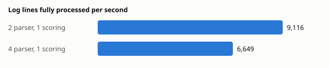

# Benchmark

Generated by `python eval/benchmark.py`. Do not edit by hand.

Run at 2026-10-21 18:21 UTC on: AMD Ryzen 7 7435HS; 16 logical cores; Docker: 16 CPUs, 7.7 GiB; Windows.
Everything (shop, pipeline, Redis, Postgres) runs on this one machine.

## Latency at a steady load

Last line of a request written → request scored. Includes the 2 s a session
waits for late lines from other services.

| Load (lines/s) | Requests scored | p50 | p99 |
|---|---|---|---|
| 300 | 1,551 | 2.36 s | 2.57 s |

## Throughput

As fast as the pipeline accepts (backpressure on), after a 30 s warm-up.

| Workers | Lines/s processed | Requests/s | Growing queue (bottleneck) |
|---|---|---|---|
| 2 parser, 1 scoring | 9,116 | 1,039.2 | raw_lines |
| 4 parser, 1 scoring | 6,649 | 759.3 | events |

## Scoring: ONNX Runtime vs PyTorch

LSTM on recorded requests, one CPU thread.

| Engine | One request p50 | One request p99 | Batches of 200 |
|---|---|---|---|
| PyTorch | 0.56 ms | 1.99 ms | 5,038 requests/s |
| ONNX Runtime | 0.10 ms | 0.20 ms | 18,206 requests/s |
